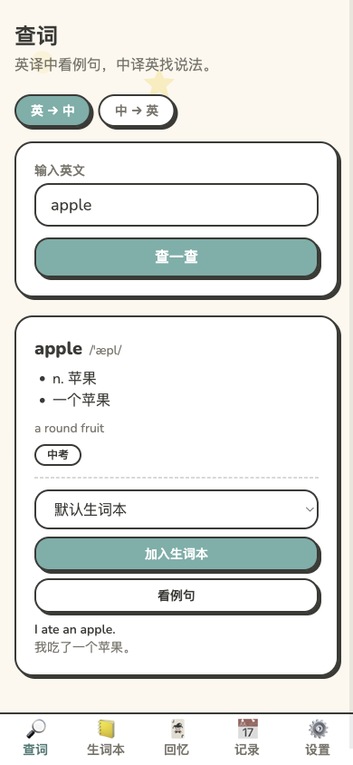
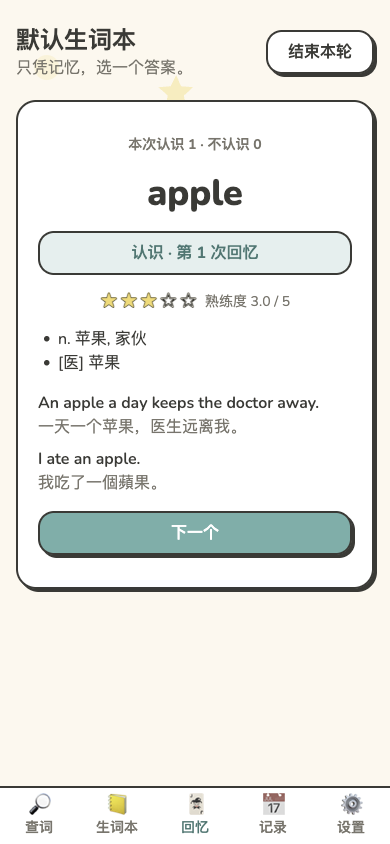
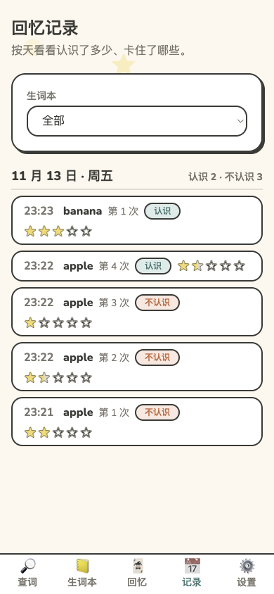

# 少儿背单词

给 8–12 岁孩子用的自托管背单词 Web 应用：查词、生词本、按熟练度随机回忆、回忆记录，一个 Docker 容器就能跑在自己的 NAS 上。

界面活泼但不抢注意力，手机和平板都能用；数据完全在自己的设备上。

| 查词 | 回忆 | 记录 |
| --- | --- | --- |
|  |  |  |

## 功能

- **查词**：英译中、中译英；英译中可看本地例句（可选 AI 补充），结果一键加入生词本；已收录的单词会标出所在生词本。
- **生词本**：可建多个生词本并指定默认本；记录加入时间；每个词有 1–10 的熟练度，新词为 5；删除生词本需要再次输入当前密码。
- **回忆**：选一个生词本，只显示英文，点「认识 / 不认识」增减熟练度并显示释义、例句和星级；本轮显示用时和认识数量 / 已回忆数量。
  - 随机权重同时考虑熟练度和上次回忆时间：越不熟、越久没复习的词越容易出现。
  - 星级为 1–5 星，支持半星。
- **回忆记录**：按天分组，记录单词、时间、第几次回忆和是否认识。
- **导入导出**：完整导出为 JSON，可合并或覆盖导入，换设备不丢数据。
- **单用户**：首次打开引导创建账号，之后关闭注册；支持修改密码和退出登录。
- **可选 AI 例句**：兼容 OpenAI Chat Completions 的服务，生成结果会缓存，失败时自动退回本地例句。

## 快速开始（Docker）

```yaml
# docker-compose.yml
services:
  study-words:
    image: <dockerhub-user>/kids-study-words:latest
    ports:
      - "8080:8080"
    volumes:
      - study-words-data:/data
    environment:
      TZ: Asia/Shanghai
      # 用 HTTPS 访问时改成 true
      COOKIE_SECURE: "false"
    restart: unless-stopped

volumes:
  study-words-data:
```

```bash
docker compose up -d
```

打开 `http://<NAS-IP>:8080`，按提示创建账号即可。镜像已内置离线词典，无需额外下载。

也可以从源码构建：

```bash
cp .env.example .env
docker compose up -d --build
```

## 配置 AI 例句（可选）

设置以下环境变量后重启容器：

| 变量 | 说明 |
| --- | --- |
| `AI_BASE_URL` | OpenAI 兼容接口地址，例如 `https://api.deepseek.com/v1` |
| `AI_API_KEY` | API key。只由服务端读取，不会写日志或渲染到页面 |
| `AI_MODEL` | 模型名，例如 `deepseek-chat` |

常见服务的 base URL：

- DeepSeek：`https://api.deepseek.com/v1`
- Kimi（Moonshot）：`https://api.moonshot.cn/v1`
- OpenAI：`https://api.openai.com/v1`

三项都配置后才启用。本地例句不足两条时才会请求 AI；结果按单词缓存，之后查同一个词不再重复请求。

## 环境变量

| 变量 | 默认值 | 说明 |
| --- | --- | --- |
| `PORT` | `8080` | 监听端口 |
| `DATA_DIR` | `./data` | SQLite 数据目录（容器内为 `/data`） |
| `DICT_PATH` | `./data/dict.db` | 离线词典路径（镜像内为 `/app/dict.db`） |
| `TZ` | `Asia/Shanghai` | 时区，影响「今天」的分组和日期显示 |
| `COOKIE_SECURE` | `false` | HTTPS 部署时设为 `true` |
| `AI_BASE_URL` | 空 | AI 接口地址 |
| `AI_API_KEY` | 空 | AI key |
| `AI_MODEL` | 空 | AI 模型名 |

## 本地开发

需要 Go 1.26+ 和 Node.js（只用于编译 Tailwind CSS）。

```bash
make fetch-data   # 下载 ECDICT（约 63MB）和 Tatoeba 句对，自动校验 SHA-256
make dict         # 生成 data/dict.db
make css          # 编译 Tailwind CSS 到 web/static/app.css
make dev          # 启动 http://localhost:8080
make test         # 运行全部测试
```

首次启动会引导创建账号。忘记密码时可以在容器内重置：

```bash
docker compose exec study-words /app/study-words reset-password <用户名>
```

## 备份与迁移

- **应用内**：设置 → 导出数据，得到包含生词本、单词、释义、例句、熟练度和回忆记录的 JSON 文件；导入时可选合并或覆盖。
- **整个实例**：备份 Docker 卷 `study-words-data`，其中 `study.db` 是全部数据。

## GitHub Actions 与镜像发布

仓库包含两个 workflow：

- `ci.yml`：`gofmt`、`go vet`、`go test`、`go build`。
- `docker.yml`：测试通过后构建 `linux/amd64` 和 `linux/arm64` 镜像并推送到 Docker Hub；
  `main` 推送 `latest` 和 `sha-*`，`v*` 标签额外发布语义化版本。

在仓库的 Actions secrets 中配置：

| Secret | 说明 |
| --- | --- |
| `DOCKERHUB_USERNAME` | Docker Hub 用户名 |
| `DOCKERHUB_TOKEN` | Docker Hub access token（不要使用账号密码） |

由仓库所有者在 GitHub 页面或本地 `gh secret set` 设置，token 不需要、也不应该出现在代码或对话里。

## 数据来源与许可

- 词条：[ECDICT](https://github.com/skywind3000/ECDICT)（MIT，固定提交并校验 SHA-256）
- 例句：[Tatoeba](https://tatoeba.org/) 中英句对，经 [manythings.org](https://www.manythings.org/anki/) 整理（CC-BY 2.0 FR）
- 前端：[htmx](https://htmx.org/)（BSD-2-Clause）、[Tailwind CSS](https://tailwindcss.com/)（MIT）、[Nunito](https://fonts.google.com/specimen/Nunito)（OFL-1.1）

详见 [THIRD_PARTY_NOTICES.md](THIRD_PARTY_NOTICES.md)。

## 已知限制

- 单用户设计：创建第一个账号后不提供注册入口。
- 只能把词典里查到的词加入生词本，不支持手动造词。
- AI 例句是可选项；不配置时使用本地句对，没有本地例句的词会显示英文释义。
- 回忆进度保存在服务端内存中，重启服务会结束当前这一轮。

## License

[MIT](LICENSE) © 2026 YaoFeng
